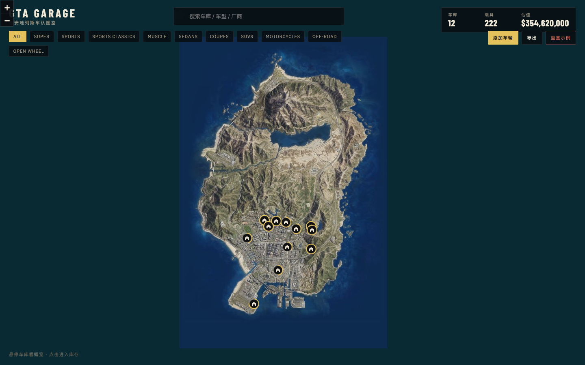

<div align="center">

[简体中文](README.md) · **English**

# GTA GARAGE

### Your cars. Your map. Your empire.

A map-first garage manager for GTA Online collectors. Turn scattered properties, vehicles, and collection progress across San Andreas into a garage map that feels like your own.

<p>
  <a href="https://icebergwuw.github.io/GTAgarage/"><strong>Open the live demo →</strong></a>
  ·
  <a href="#features">Features</a>
  ·
  <a href="#run-locally">Run locally</a>
</p>

<p>
  
  
  
  
  
</p>



</div>

<br />

> **Turn “Where did I park that?” into a map you can actually explore.**

## Why this exists

GTA Online keeps adding vehicles while properties, floors, and capacity rules become harder to track. GTA Garage treats the garage as a collection experience instead of a spreadsheet:

- Find every property on a familiar San Andreas map.
- Read capacity, inventory fill, and vehicle previews at a glance.
- Enter a garage floor and browse it like a personal virtual showroom.
- Track collection progress with a vehicle dex and class achievements.

## Features

| Map-first inventory | Property management | Vehicle dex |
| --- | --- | --- |
| Show owned properties on the map and open a garage from its marker. | Follow GTA Online-style purchase, trade-in, sale, and capacity rules. | Browse vehicles by class and inspect specs, manufacturers, real-life references, and progress. |

| Fast organization | Local-first data | Responsive layout |
| --- | --- | --- |
| Search garages, addresses, vehicles, and manufacturers; move vehicles between garages in batches. | Persist data in the browser, export JSON, or restore the sample fleet. | A desktop map workspace with a mobile-friendly layout. |

## Interaction preview

<table>
  <tr>
    <td width="50%"></td>
    <td width="50%"></td>
  </tr>
  <tr>
    <td align="center"><sub>Map overview: inventory, value, and garage distribution</sub></td>
    <td align="center"><sub>Inventory panel: floors, capacity, and vehicle previews</sub></td>
  </tr>
  <tr>
    <td width="50%"></td>
    <td width="50%"></td>
  </tr>
  <tr>
    <td align="center"><sub>Hover preview: scan a garage without opening the panel</sub></td>
    <td align="center"><sub>Vehicle details: notes, plate, color, and relocation</sub></td>
  </tr>
</table>

## Run locally

```bash
git clone https://github.com/icebergwuw/GTAgarage.git
cd GTAgarage
npm install
npm run dev
```

Then open the local URL printed by Vite. To create a production build:

```bash
npm run build
```

## How to use

1. Start in **My garages**. The map only shows properties owned by the sample fleet.
2. Click a property marker to open its floors and vehicle inventory.
3. Search for a garage, address, vehicle, or manufacturer from the top bar.
4. Select **Buy property** to browse available locations; hollow markers are purchasable.
5. Open **Dex** to browse the full vehicle catalog and class progress.
6. Use **Export** to save your current local fleet as JSON.

## Tech stack

- **UI**: React 19 + TypeScript
- **Map**: Leaflet + Rockstar Social Club San Andreas map tiles
- **Motion**: Framer Motion
- **Build**: Vite
- **Data**: Browser `localStorage`; no backend or account required
- **Deployment**: GitHub Actions + GitHub Pages

## Scope and attribution

The project focuses on standard personal vehicle storage in GTA Online. It currently excludes bunkers, facilities, cargo warehouses, vehicle warehouses, yachts, Kosatka, salvage yards, car washes, and McKenzie Field Hangar.

Vehicle images and references come from FiveM / GTA Wiki. This is a personal, non-commercial project and is not affiliated with Rockstar Games.

## Roadmap

- [x] Map-based garages and floor inventory
- [x] Property purchase, sale, trade-in, and capacity rules
- [x] Vehicle search, relocation, batch organization, and JSON export
- [x] Vehicle dex and class achievements
- [x] GitHub Pages live demo
- [ ] Custom garage covers and collection tags
- [ ] Optional cloud sync / account system
- [ ] More complete vehicle data and filters

## Feedback and ideas

If you also have a GTA Online fleet that got out of hand, open an Issue. Tell me which garage you want to manage, which filter you use most, or which vehicle fields should be added to the dex.

<div align="center">

**Built for collectors who never stop buying cars.**

<a href="https://icebergwuw.github.io/GTAgarage/">Open GTA Garage →</a>

</div>
